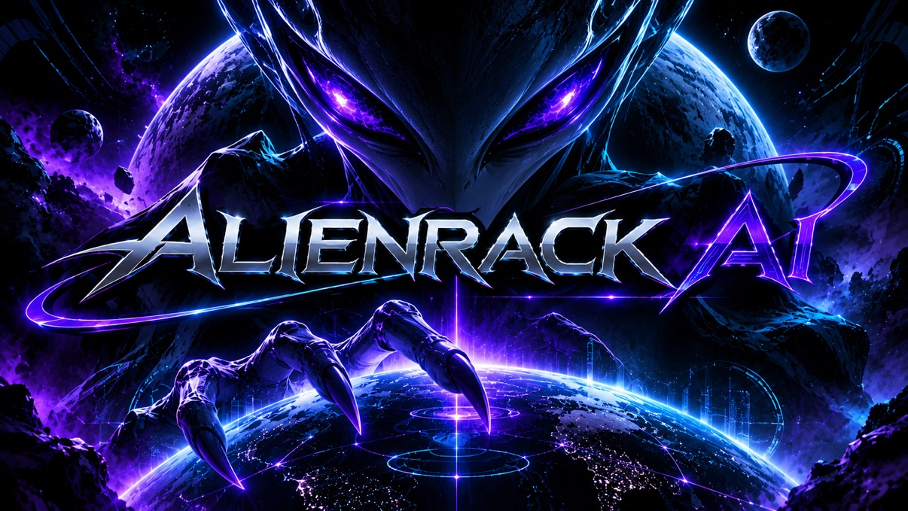

# AlienRACK AI

**An AI-driven Command & Control (C2) framework for professional red team operations.**

AlienRACK is a custom-built C2 framework that integrates AI into the post-exploitation workflow. Instead of manually driving every step, operators can let the AI plan and execute the attack chain — with human oversight where it matters.

🌐 **Official site / inquiries:** https://alienrack.dev

> ⚠️ **Authorized use only.** AlienRACK is developed for professional penetration testing and red team engagements conducted with explicit written authorization. Use against systems you do not own or have permission to test is illegal.

> **Note:** The source code is not publicly available, to prevent misuse. AlienRACK is provided to verified professional customers through the official site.

## Demo

🎥 **Watch the full demo on YouTube:** https://www.youtube.com/watch?v=N2CvWGyTeL4
Full attack-chain walkthrough: OSINT → Recon → Exploitation → C2 Post-Exploitation → Exfiltration.

## Core Features

- **Agent deployment & remote tasking** — Deploy agents to target systems and control them remotely
- **Multi-session management** — Handle multiple active sessions simultaneously from a single panel
- **Encrypted communications** — Commands and results are exchanged over encrypted channels

## AI Integration

AlienRACK automates the full attack chain:

**Recon → Exploit → C2 Establishment → Lateral Movement → Exfiltration**

- The AI decides the next action based on the current state of the operation and executes it
- **Human Review with confidence thresholds** — When the AI's confidence falls below 70%, the action is escalated to a human operator for approval before execution. Automation where it's safe, judgment where it counts

## Integration with ALIEN PENTEST

AlienRACK is designed to work together with **ALIEN PENTEST**, our automated penetration testing platform:

- Intelligence gathered during the RECON phase is handed off directly to the C2 phase
- Active C2 sessions are visible in the session management panel
- The attack graph extends through C2 → Lateral Movement → Exfiltration phases

## Status

AlienRACK is under active development.

## Get Access

AlienRACK is available to verified security professionals and organizations.
For licensing, demos, and inquiries, please visit the official site:
Pricing: $99/month or $990/year — all features included. Available to verified security professionals and organizations.
🌐 https://alienrack.dev

---

*Built by Zer0 — penetration tester & security tool developer.*
